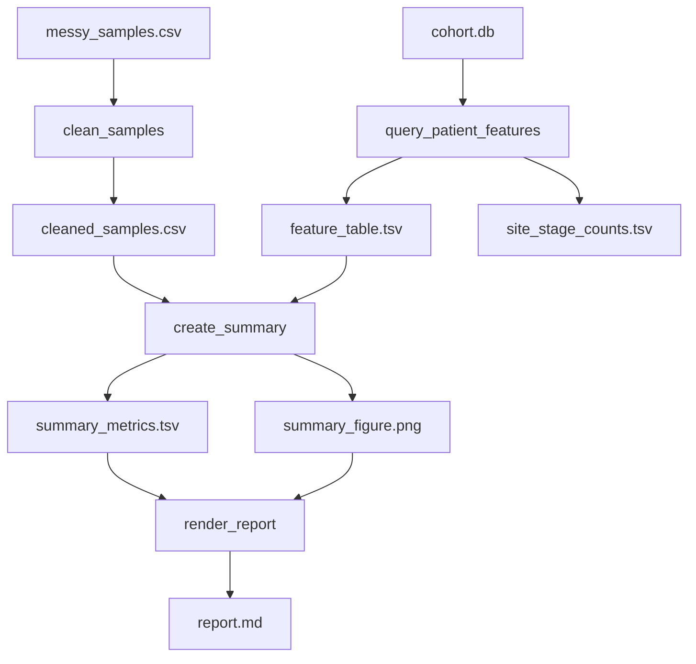

# Lab 5: Scalable Analysis Workflow

## Overview

This project uses Snakemake to organize work from Labs 3 and 4 into a reproducible workflow with four processing stages:

1. Clean the clinical sample CSV using the rules established in Lab 3.
2. Query the Lab 4 cohort database to construct patient features.
3. Generate summary metrics and a figure from the two datasets.
4. Generate a Markdown report from the summary outputs.

The clinical sample dataset and cohort database describe independent populations. Their identifiers do not match, and no mapping table is available. They are summarized separately rather than joined at the record level, consistent with the removal of the merge task from the [Lab 5 instructions](https://github.com/gwcbi/applied-computing-HDS/blob/main/labs/lab5-scalable-workflow/README.md).

## Repository Structure

```text
.
├── Snakefile
├── requirements.txt
├── README.md
├── AI_USAGE.md
├── .gitignore
├── data/
│   ├── raw/
│   │   ├── messy_samples.csv
│   │   └── cohort.db
│   └── processed/
│       ├── cleaned_samples.csv
│       ├── feature_table.tsv
│       └── site_stage_counts.tsv
├── scripts/
│   ├── clean_samples.py
│   ├── build_feature_table.py
│   ├── query1_gene_counts.sql
│   ├── query2_site_stage_counts.sql
│   ├── create_summary.py
│   └── render_report.py
├── results/
│   ├── summary_metrics.tsv
│   ├── summary_figure.png
│   └── report.md
├── logs/
│   ├── clean_samples.log
│   ├── query_patient_features.log
│   ├── create_summary.log
│   └── render_report.log
└── evidence/
    ├── full_clean_run.txt
    ├── up_to_date.txt
    ├── partial_rerun_plan.txt
    ├── partial_rerun.txt
    ├── restoration_run.txt
    ├── final_up_to_date.txt
    └── messy_samples.original.csv
```

## Environment and Setup

The workflow was tested on macOS with:

- Python 3.13.5
- Snakemake 9.27.1
- pandas 3.1.1
- matplotlib 3.11.2

From the repository root, use Python 3.13.5 to create and activate a virtual environment:

```bash
python3.13 --version
python3.13 -m venv .venv
source .venv/bin/activate
python -m pip install -r requirements.txt
```

The first command should report Python 3.13.5 for the tested environment. If that version is installed under a different executable name, use that executable to create the virtual environment.

Verify the environment:

```bash
python --version
snakemake --version
```

The Snakefile uses `sys.executable` to run scripts with the same Python interpreter that runs Snakemake. Shell paths are quoted using Snakemake's `:q` formatting.

## Workflow Dependencies



`rule all` requests all six generated data and report files. It is a target rule rather than an additional processing stage.

Each processing rule declares its script as an input. The database rule also declares both SQL files, which are read internally by `build_feature_table.py`. Changes to data, Python scripts, or SQL files can therefore trigger the appropriate dependent rules.

`site_stage_counts.tsv` is an additional database output requested by `rule all`; the summary stage uses `feature_table.tsv`.

The clinical cleaning and database query branches can run concurrently with two available cores.

## Run the Workflow

Preview the execution plan:

```bash
snakemake --cores 2 --dry-run
```

Execute the workflow:

```bash
snakemake --cores 2 --printshellcmds
```

Check whether any work remains:

```bash
snakemake --cores 2 --dry-run
```

After a successful run with unchanged inputs, the expected message is:

```text
Nothing to be done (all requested files are present and up to date).
```

## Full Clean Run

Run these commands from the repository root in Bash or Zsh with the virtual environment activated.

First inspect the generated files that Snakemake will delete:

```bash
snakemake --delete-all-output --dry-run
```

The deletion list should contain only these generated outputs:

```text
data/processed/cleaned_samples.csv
data/processed/feature_table.tsv
data/processed/site_stage_counts.tsv
results/summary_metrics.tsv
results/summary_figure.png
results/report.md
```

Delete those outputs and rebuild the workflow:

```bash
mkdir -p evidence
set -o pipefail

snakemake --delete-all-output

snakemake --cores 2 --printshellcmds 2>&1 \
  | tee evidence/full_clean_run.txt

snakemake --cores 2 --dry-run 2>&1 \
  | tee evidence/up_to_date.txt
```

Raw inputs are retained. The clean run completed all four processing rules and `all`, reporting:

```text
5 of 5 steps (100%) done
```

The follow-up dry run confirmed that all requested files were up to date.

Running commands with `tee` again replaces the corresponding evidence file.

## Partial Rerun Demonstration

The incremental execution test changed the first clinical sample's `notes` field to `Incremental rerun demonstration`. The database, SQL files, and scripts were unchanged.

To reproduce the test, start with an up-to-date workflow and preserve the original CSV bytes. The following commands use a temporary backup directory:

```bash
rerun_backup_dir=$(mktemp -d)

cp data/raw/messy_samples.csv \
  "$rerun_backup_dir/messy_samples.original.csv"

python - <<'PY'
import csv
from pathlib import Path

path = Path("data/raw/messy_samples.csv")

with path.open(newline="", encoding="utf-8") as handle:
    reader = csv.DictReader(handle)
    columns = reader.fieldnames
    rows = list(reader)

rows[0]["notes"] = "Incremental rerun demonstration"

with path.open("w", newline="", encoding="utf-8") as handle:
    writer = csv.DictWriter(handle, fieldnames=columns)
    writer.writeheader()
    writer.writerows(rows)

print("Changed the first clinical sample note.")
PY
```

Save the execution plan and run the workflow without forcing any rules:

```bash
set -o pipefail

snakemake --cores 2 --dry-run 2>&1 \
  | tee evidence/partial_rerun_plan.txt

snakemake --cores 2 --printshellcmds 2>&1 \
  | tee evidence/partial_rerun.txt
```

The recorded run executed:

```text
clean_samples
create_summary
render_report
all
```

It completed with:

```text
4 of 4 steps (100%) done
```

`query_patient_features` did not run because none of its inputs changed. The cleaning rule reported the updated raw CSV as its rerun reason.

Changing a note does not alter the numeric summary. Nevertheless, the summary and report rules rerun because their upstream files are regenerated. This demonstrates dependency tracking rather than a change in the statistical results.

Restore the original input in the same terminal session and regenerate its dependent outputs:

```bash
cp "$rerun_backup_dir/messy_samples.original.csv" \
  data/raw/messy_samples.csv

cmp data/raw/messy_samples.csv \
  "$rerun_backup_dir/messy_samples.original.csv"

snakemake --cores 2 --printshellcmds 2>&1 \
  | tee evidence/restoration_run.txt

snakemake --cores 2 --dry-run 2>&1 \
  | tee evidence/final_up_to_date.txt
```

`cmp` produces no output when the files match. The temporary backup remains available in the directory named by `rerun_backup_dir`.

For the submitted demonstration, the original backup is retained as `evidence/messy_samples.original.csv`. The restored raw CSV was verified to match both that backup and the original Lab 3 input byte for byte. The final dry run confirmed that all outputs were up to date.

## Data Processing and Validation

### Clinical Samples

The raw clinical CSV contains 60 records and eight columns.

The Python cleaning script reuses the Lab 3 rules to:

- Standardize sample IDs to `S` followed by four digits.
- Convert names to title case.
- Standardize dates to `YYYY-MM-DD`.
- Interpret two-digit years 50–99 as 1950–1999 and 00–49 as 2000–2049.
- Standardize sex to `Male`, `Female`, or `Unknown`.
- Standardize enrollment sites to `Site A`, `Site B`, or `Site C`.
- Extract numeric glucose values and multiply values recorded in mmol/L by 18.
- Standardize glucose units to mg/dL.

The script validates required columns, sample ID format and uniqueness, recognized sites and glucose units, and nonmissing glucose measurements.

The resulting table contains 60 rows and eight columns. All columns matched the Lab 3 regex-cleaned output after aligning sample IDs and treating blank and NA notes as equivalent missing values.

### Patient Features

The database contains:

| Table | Rows |
| --- | ---: |
| patients | 566 |
| samples | 566 |
| mutations | 200,789 |
| genes | 17,756 |

The reused Lab 4 script retains all patients and constructs an 11-column feature table. It requires at most one sample per patient for the sample-level features; the supplied database has exactly one sample for each patient.

Query 1 counts non-Silent mutation records for TP53, KRAS, EGFR, STK11, and KEAP1, including zero-count patient-gene combinations. Query 2 counts distinct patients by tissue source site and stage, retaining missing-stage groups.

Validation results:

| Check | Result |
| --- | ---: |
| Patients before and after sample join | 566 / 566 |
| Patient-gene rows | 2,830 |
| Site-stage groups | 142 |
| Feature table dimensions | 566 rows × 11 columns |
| Missing sex | 52 |
| Missing age at diagnosis | 71 |
| Missing stage | 54 |

Gene totals were checked against independent counts from the mutation table:

| Gene | Non-Silent mutation records |
| --- | ---: |
| TP53 | 305 |
| KRAS | 172 |
| EGFR | 85 |
| STK11 | 81 |
| KEAP1 | 103 |

SQL NULL clinical values are exported as `NA`. Zero mutation counts mean no qualifying record was found; they do not establish biological absence or sufficient sequencing coverage.

## Results and Limitations

The generated [analysis report](results/report.md) includes clinical glucose statistics, clinical missingness, gene mutation totals, and the [summary figure](results/summary_figure.png).

Clinical glucose statistics are:

| Metric | mg/dL |
| --- | ---: |
| Mean | 735.05 |
| Median | 170.10 |
| Minimum | 77.20 |
| Maximum | 4,341.60 |

Thirteen converted glucose values exceed 1,000 mg/dL. The cleaning follows the recorded units literally, preserving questionable source values rather than assuming corrected units. These extreme values affect the mean and histogram and require source verification before further analysis.

The gene chart counts mutation records, not distinct patients with mutations. The two cohorts are summarized independently, and no cross-cohort patient-level inference is made.

## Execution Evidence

| File | Purpose |
| --- | --- |
| [full_clean_run.txt](evidence/full_clean_run.txt) | Successful execution from missing generated outputs |
| [up_to_date.txt](evidence/up_to_date.txt) | No additional work after the clean run |
| [partial_rerun_plan.txt](evidence/partial_rerun_plan.txt) | Planned rules after changing the clinical CSV |
| [partial_rerun.txt](evidence/partial_rerun.txt) | Actual incremental execution with the database branch skipped |
| [restoration_run.txt](evidence/restoration_run.txt) | Regeneration after restoring the original CSV |
| [final_up_to_date.txt](evidence/final_up_to_date.txt) | Final confirmation that outputs are current |

Per-rule stdout and stderr are saved in `logs/`.

## AI Assistance

AI assistance with script development, workflow syntax, debugging, documentation, and execution verification is documented in [AI_USAGE.md](AI_USAGE.md).