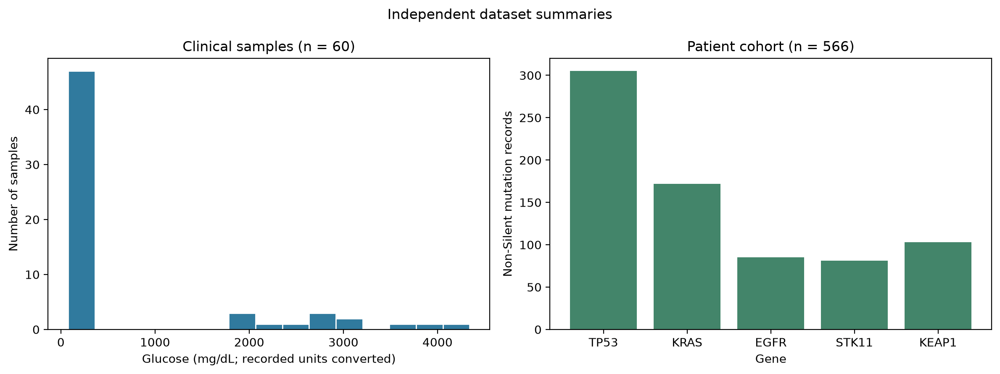

# Lab 5 Analysis Summary

## Data Sources and Scope

The clinical sample dataset contains 60 records from Lab 3.
The patient feature table contains 566 patients from the Lab 4
cohort database.

These datasets describe independent cohorts. Clinical sample identifiers
use the S0001 format, whereas the database uses TCGA identifiers. No shared
identifier or mapping table is available, so the datasets are summarized
separately without a row-level join.

## Clinical Sample Summary

| Metric | Glucose (mg/dL) |
| --- | ---: |
| Mean | 735.05 |
| Median | 170.10 |
| Minimum | 77.20 |
| Maximum | 4341.60 |

Cleaning follows the Lab 3 rules for identifiers, dates, sex, enrollment
sites, and glucose units. Values recorded in mmol/L are multiplied by 18.

Some source measurements have questionable unit labels. Literal conversion
produces extreme glucose values, which are retained rather than silently
corrected. These measurements require source verification before further
analysis. The mean and histogram are sensitive to these extreme values.

## Patient Feature Summary

All 566 patients are retained. Clinical missing values remain
missing and are not replaced with zero.

| Clinical field | Missing patients |
| --- | ---: |
| sex | 52 |
| age_at_diagnosis | 71 |
| stage | 54 |

The following totals count mutation records classified as non-Silent.
They do not represent counts of distinct patients with mutations.

| Gene | Non-Silent mutation records |
| --- | ---: |
| TP53 | 305 |
| KRAS | 172 |
| EGFR | 85 |
| STK11 | 81 |
| KEAP1 | 103 |

A zero gene count means no qualifying mutation record was found in the
database. It does not establish biological absence or adequate sequencing
coverage.

## Summary Figure

## Workflow

The workflow cleans clinical samples and queries the cohort database in
independent branches. Their outputs feed the summary stage, which produces
metrics and a figure. This report is generated from those summary outputs.
